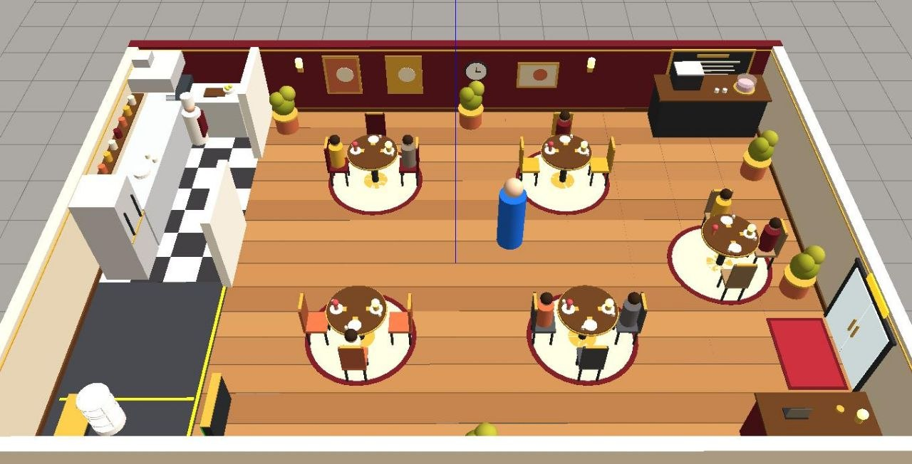

# 🤖 Autonomous Restaurant Service Robot (ROS 2 Humble)

An end-to-end autonomous waiter robot simulation designed for restaurant service, built using ROS 2 Humble, Nav2, Gazebo 11, and RViz2, featuring a custom Python GUI and Offline Voice Recognition (Vosk).

---

## 📸 System Preview & Simulation

### 1. Custom Waiter Robot Model & Restaurant Environment (Gazebo)

### 2. Full Simulation & Control Panel Overview

### 3. Autonomous Navigation & LiDAR Mapping (RViz2 & Nav2)

### 4. Smart AI Control Panel (GUI & Offline Voice Recognition)

---

## 🚀 Key Engineering Features
- Autonomous Navigation & Path Planning (Nav2): Real-time localization using AMCL and 360° LiDAR, calculating optimal delivery paths across 5 restaurant tables while avoiding obstacles.
- Custom Robot Modeling (URDF/Xacro): Differential-drive mobile base equipped with 3 serving trays, 360° LiDAR, and RGB Camera sensors.
- Interactive Control Panel (Python/Tkinter): Real-time monitoring of tray status, delivery queues, and system logs.
- Offline Voice Commands (Vosk): Hands-free order dispatching via offline speech recognition without internet dependency.
- Automated Docking: Automatic return to the charging station upon completing deliveries.

---

## 🛠️ Tech Stack
ROS 2 Humble • Nav2 • Gazebo 11 • RViz2 • Python 3 • Tkinter • Vosk ASR • URDF • Ubuntu 22.04

---

## 📩 Contact & Collaboration
Developed by Abedalghani — *Robotics & Intelligent Systems Engineer*.  
Available for custom ROS 2 simulations, autonomous navigation projects, and robotics consulting.

---

---

### 📩 Contact for Projects & Inquiries
If you are interested in this project or need a custom robotics simulation (ROS 2 / Gazebo) or 3D CAD design (SolidWorks), feel free to reach out directly:

* Email: abedalghani1234@gmail.com
* Telegram: [@AbedalghaniJaddoa](https://t.me)
